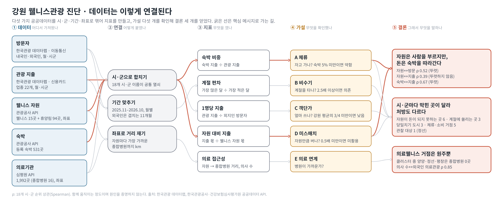
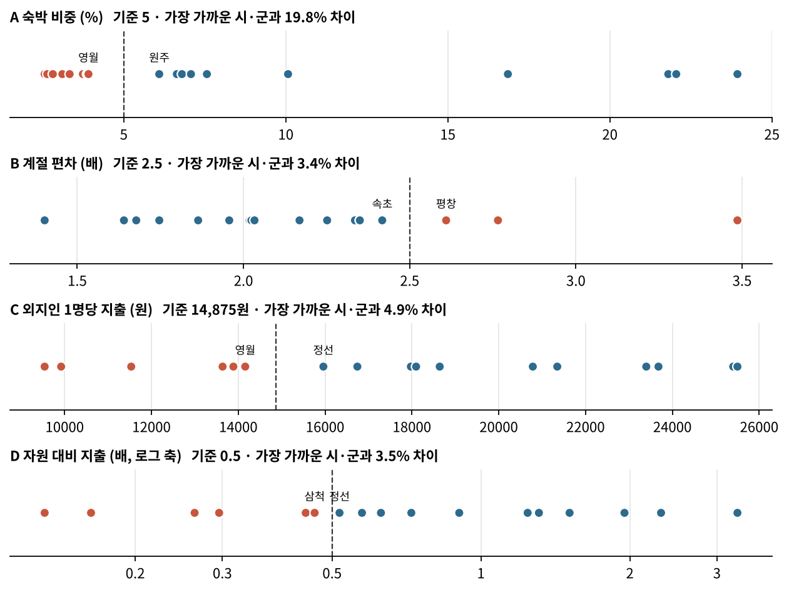

# 강원 웰니스관광 수용태세 진단

> **웰니스 자원은 사람을 부르지만, 머물고 돈을 쓰게 하지는 못한다.**
> 강원 18개 시·군 데이터로 보면, 지출과 함께 움직이는 것은 자원이 아니라 숙박이다. 병목은 머물 수 있는 기반으로 보인다.



## 한눈에

### 1. 말하고 싶은 것

강원은 숲·온천 같은 웰니스 자원이 많고 2026년 정부 웰니스 관광 클러스터로 선정됐다. 그런데 **자원이 관광객의 체류와 소비로 이어지고 있을까?** 이어지지 않는다면 시·군마다 어디가 막혀 있을까?

### 2. 무엇으로 무엇을 했나

| 무엇으로 | 무엇을 |
|---|---|
| 공공데이터 5종: 데이터랩 방문자·카드 지출, 관광공사 웰니스·관광정보 API, 심평원 병원 API | 18개 시·군 × 12개월로 연결 (시·군 이름, 기간, 좌표) |
| 지표 5개: 숙박 비중, 계절 편차, 1명당 지출, 자원 대비 지출, 의료 접근성 | 가설 A~E 검정, 시·군 진단·처방 묶음 |
| 검증 3가지: 순위 상관, 기준값 ±20% 민감도, k-means 군집 비교 | 결론이 기준이나 방법에 좌우되지 않는지 확인 |

### 3. 결과

| 결과 | 숫자 |
|---|---|
| 자원이 많은 곳에 **사람은 더 온다** | 자원↔외지인 방문 ρ=0.52 (p=0.03) |
| 하지만 자원과 **지출은 뚜렷하게 함께 움직이지 않는다** | 자원↔관광 지출 ρ=0.39 (p=0.11) |
| 지출과 함께 움직이는 것은 **숙박**이다 | 등록 숙박 수↔관광 지출 ρ=0.67 (p=0.003) |
| 18곳 중 **6곳**은 자원 몫의 절반도 벌지 못한다 | 자원 대비 지출 0.5배 미만 |
| 웰니스 클러스터 4곳 중 **3곳(양양·정선·평창)** 이 자원 몫만큼 벌지 못한다 | 자원 대비 지출 1배 미만 |
| 의료웰니스를 받을 준비가 된 클러스터는 **원주뿐**이다 | 양양·정선·평창 종합병원 0곳 · 의사 수↔외국인 의료관광 ρ=0.85 |

### 4. 알게 된 것

**웰니스 자원은 사람을 부르지만, 돈은 숙박을 따라간다.** 자원을 늘리는 것보다 머물 수 있는 기반을 만드는 것이 먼저로 보인다. 막힌 곳이 시·군마다 달라 처방도 달라야 한다.

| 처방 묶음 | 시·군 | 처방 |
|---|---|---|
| 자원이 돈이 되지 못하는 곳 | 인제, 삼척, 영월, 철원, 화천, 양구 | 휴양림·온천 같은 웰니스 자원을 숙박과 묶은 체류 상품 |
| 계절에 쏠리는 곳 | 평창, 고성, 양양 | 여름·스키철 밖을 채우는 웰니스·수면 프로그램 |
| 당일치기 도시 | 춘천, 동해, 태백 | 1박을 만드는 저녁·웰니스 콘텐츠 |
| 체류·소비 거점 | 원주, 강릉, 속초, 홍천, 횡성 | 주변 군 지역으로 방문객을 보내는 허브 |
| 관찰 대상 | 정선 | 네 기준 모두 경계 근처라 다음 해 데이터로 다시 진단 |

**인과에 대해.** 18개 시·군의 1년치 비교라 위 관계는 '함께 움직인다'는 연관이며 인과를 증명하지 않는다. 그래서 결론은 "숙박이 원인이다"가 아니라 "근거로 보면 병목은 숙박으로 보인다"는 가설로 둔다.

## 가설과 지표

| 가설 | 지표 | 기준 |
|---|---|---|
| A 체류: 외지인은 오지만 자고 가지 않는다 | 관광 지출 중 숙박 비중 | 5% 미만 |
| B 비수기: 계절 편차가 크다 | 월 지출 최고 ÷ 최저 | 2.5배 이상 |
| C 객단가: 스쳐 가는 지역은 덜 쓴다 | 외지인 1명당 관광 지출 | 강원 평균의 3/4 미만 (약 14,875원) |
| D 미스매치: 자원만큼 돈이 안 들어온다 | 지출 점유 ÷ 웰니스 자원 점유 | 0.5배 미만 |



**기준을 정한 원칙**

1. **한 문장으로 설명되는 값**: 숙박이 관광 지출의 20분의 1도 안 됨 · 비수기 한 달 지출이 성수기의 40%도 안 됨 · 강원 평균의 4분의 3 미만 · 자원 몫의 절반도 못 범
2. **값이 끊기는 자리**: 18개 시·군 값 사이 빈 구간에 두어, 가장 가까운 시·군과 3% 이상 떨어지게 했다 (`test_thresholds_sit_in_gaps`로 확인)
3. **흔들림 공개**: 기준을 각각 ±20% 바꾼 81가지 경우에서 평균 81%가 같은 진단을 유지했다. 경계 지역(삼척·영월·정선 44%, 양양 59%)은 진단표에 유지율을 함께 적었다. 규칙 없이 k-means로 묶어도(k=3) 큰 줄기가 같았다(ARI 0.56).

'거점'은 문제가 없다는 이유만으로 붙이지 않는다. 1명당 지출이 강원 평균 이상이고 자원 몫 이상을 벌 때만 거점으로 보고, 그렇지 않으면 관찰 대상으로 둔다.

## 데이터

| 데이터 | 출처 | 범위 |
|---|---|---|
| 내국인 방문자(현지인·외지인) | 한국관광 데이터랩, 이동통신(KT) | 2025.11~2026.10, 월별 |
| 외국인 방문자 | 한국관광 데이터랩, 이동통신(SKT) | 2025.10~2026.09, 월별 |
| 관광 지출(내국인·외국인, 업종 22개) | 한국관광 데이터랩, 신용카드 | 2025.11~2026.10, 월별 |
| 웰니스 관광지 | 공공데이터포털, 한국관광공사 웰니스관광정보 API | 강원 15곳 |
| 의료기관 | 공공데이터포털, 건강보험심사평가원 병원기본목록 API | 강원 1,992곳 |
| 관광정보 전체(숙박·휴양림 등) | 공공데이터포털, 한국관광공사 국문 관광정보 API | 강원 4,683건 |

## 폴더 구조

```
강원웰니스진단
├── README.md                     프로젝트 소개 (이 파일)
├── requirements.txt              필요한 파이썬 패키지
├── 1_데이터
│   ├── 원본_데이터랩              한국관광 데이터랩에서 내려받은 zip (그대로 보관)
│   │   ├── 내국인_방문자
│   │   ├── 외국인_방문자
│   │   ├── 내국인_지출
│   │   └── 외국인_지출
│   ├── 원본_API                  공공데이터포털 API 수집 결과 (웰니스·숙박·관광정보·의료기관)
│   └── 가공                      파이프라인 결과 (지표·진단·민감도·대시보드용 CSV)
├── 2_코드
│   ├── 데이터수집                 API 수집 스크립트 (코랩에서 실행)
│   │   ├── collect_tour_api.py      웰니스관광정보·국문 관광정보
│   │   └── collect_hospitals.py     심평원 병원기본목록
│   ├── 분석모듈/gwdx              분석 패키지 (파이썬 패키지라 영어 이름)
│   │   ├── config.py                경로·기간·진단 기준값·처방
│   │   ├── load.py                  원자료 불러오기 (zip 머리글로 종류 자동 구분)
│   │   ├── features.py              시·군 지표, 의료 접근성 계산
│   │   ├── diagnose.py              A~D 진단, 유형·묶음, 민감도 분석
│   │   └── plotting.py              그림 공통 설정
│   ├── 실행스크립트
│   │   ├── run_pipeline.py          원자료 → 지표 → 진단 → CSV
│   │   ├── build_notebook.py        분석 노트북 생성·실행
│   │   └── draw_data_map.py         데이터 연결 지도 그리기
│   └── 테스트
│       └── test_diagnose.py         분류 규칙·기준값 위치·데이터 무결성·의료 지표 테스트 (16개)
├── 3_분석노트북
│   └── 01_analysis.ipynb          가설 A~E 검정, 민감도, 군집 검증 (실행 결과 포함)
└── 4_결과물
    ├── 그림                       분석 그림 8장
    ├── 데이터연결지도              data_map.png / .svg
    └── 대시보드                   dashboard_link.txt (링크), index.html (페이지 코드 보관)
```

## 실행 방법

`강원웰니스진단` 폴더에서 실행합니다.

```bash
pip install -r requirements.txt

# 1) (선택) API 데이터 새로 받기 — 공공데이터포털 인증키(Decoding) 필요, 결과 CSV는 1_데이터/원본_API로 옮긴다
python 2_코드/데이터수집/collect_tour_api.py
python 2_코드/데이터수집/collect_hospitals.py

# 2) 지표·진단 계산 → 1_데이터/가공
python 2_코드/실행스크립트/run_pipeline.py

# 3) 테스트
python -m pytest -q 2_코드/테스트

# 4) 분석 노트북: 3_분석노트북/01_analysis.ipynb 를 열어 위에서부터 실행
```

코랩에서 노트북을 열 때는 한글 그림을 위해 먼저 `!apt-get -qq install fonts-nanum`을 실행하고 런타임을 다시 시작합니다.

## 한계

- 방문자 수는 같은 사람을 여러 번 셀 수 있고, 외지인에는 출장·통근이 섞여 있어 시·군끼리 비교하는 용도로만 썼습니다.
- 카드 가맹점 위치로 집계되어 숙박 앱·여행사 선결제가 빠질 수 있습니다. 숙박 비중과 외국인 지출이 낮게 잡힐 수 있습니다.
- 웰니스 자원은 한국관광공사 등록 기준이라 실제 업소 수와 다릅니다.
- 18개 시·군의 1년치 횡단면 비교라 상관관계가 인과를 뜻하지는 않습니다.
- 종합병원까지 거리는 직선거리이고, 외국인 의료관광 지출은 강원 전체 약 18억 원으로 규모가 작습니다.

## 다음 단계

- 도로 기준 이동 시간으로 의료 접근성 보완
- 숙박 인허가 데이터로 숙박 인프라 지표 보완
